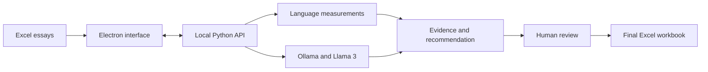

# Technical presentation and research defense guide

Prepared from the inspected repository on October 19, 2026. Read this alongside
the [technical reference](TECHNICAL_REFERENCE.md) and
[validation report](VALIDATION_REPORT.md).

## Your opening explanation

> Our system is a local human-in-the-loop application for evaluating ESL academic
> writing. It combines measurable language features with Llama 3's rubric-based
> judgments. The model recommends a grade, but a human rater reviews the essay
> and supporting evidence and makes the final placement decision. We built the
> interface with Electron, used Python for scoring and workbook processing, and
> ran Llama 3 locally through Ollama.

The three ideas your audience should remember are **measurable evidence,
rubric interpretation, and human authority**.

## Suggested 12-part presentation, approximately 12–15 minutes

Each numbered part can become one slide. The quoted passages are speaker notes,
not claims that every design choice has already been experimentally validated.

### 1. The research problem

Show: **Writing quality has both measurable and interpretive dimensions.**

Say:

> A language-feature extractor can count words, estimate vocabulary diversity,
> and identify grammar-related rule matches. Those measurements are useful,
> but they cannot by themselves establish whether the writer develops an
> argument, supports ideas effectively, or responds to the task. Our design
> adds an LLM assessment of those rubric qualities and keeps a human responsible
> for the final decision.

Be ready to distinguish the research question from the finding: combining
evidence is the design; improved human agreement is something to test.

### 2. What HITL means in this application

Show: **AI recommendation → human review → final grade and placement.**

Say:

> Human-in-the-loop means that processing an essay does not automatically
> finalize its assessment. Every new essay starts as Pending. The reviewer
> reads the essay, sees the model's grade and language evidence, then accepts
> the recommendation or selects a different whole-number grade. The saved
> workbook records the final grade, placement, action, and timestamp.

Do not describe human overrides as automatic model training. The current
application saves decisions but does not learn from them during use.

### 3. The software architecture

Show:

Say:

> Electron provides the desktop window and starts the Python backend. The
> interface sends the uploaded workbook to a local HTTP API. Python extracts
> features and sends a rubric prompt to the local Ollama model server. The
> resulting evidence and recommendation are saved to Excel and shown for human
> review. These components communicate on the same computer in the default
> deployment.

Electron is the desktop shell; Python performs assessment orchestration;
Ollama is the model runtime; Llama 3 is the language model.

### 4. Technologies and their specific roles

Show this compact mapping:

| Need | Technology |
| --- | --- |
| Desktop application | Electron and Node.js |
| Current interface | HTML, CSS, JavaScript |
| Processing and local API | Python standard library |
| Linguistic parsing | spaCy `en_core_web_sm` |
| Vocabulary measures | wordfreq, lexical-diversity, AWL data |
| Grammar-related evidence | LanguageTool and Java |
| Semantic rubric scoring | `llama3:8b` through Ollama |
| Excel input and persistence | openpyxl |
| Distribution | PyInstaller, electron-builder, Windows installer helper |

Say:

> Each tool has a separate role. spaCy supplies the linguistic structure;
> LanguageTool supplies writing-rule matches; and Llama 3 provides semantic
> rubric judgments. openpyxl connects the assessment pipeline to the workbooks
> that raters use. PyInstaller packages the Python backend, while Electron's
> packaging tools assemble the desktop distribution.

The repository also has React/Vite and Colab experiments. Specify that those
are separate paths if they appear in a repository screenshot.

### 5. What the rule-based component measures

Show four groups:

- **Lexical:** word count, vocabulary frequency, MTLD, AWL ratio, TTR, word length.
- **Syntactic:** sentence length, clause-density proxy, dependency depth, noun complexity.
- **Cohesion:** connective density and adjacent-sentence lexical overlap.
- **Grammar-related:** LanguageTool matches per 100 words.

Say:

> These are interpretable measurements. For example, an AWL ratio of 0.08 means
> that eight percent of the counted word tokens match our academic word list.
> A grammar density of four means that LanguageTool produced four matches per
> hundred words. We call these evidence because a high number alone does not
> prove good writing. Repetition can increase overlap, and rare vocabulary can
> still be used incorrectly.

There are twelve shared features, plus HITL's paragraph count, TTR, and average
word length. The displayed dashboard shows a subset of the stored evidence.

### 6. How the manual AES score works

Show: **25% MTLD + 30% AWL + 20% inverted frequency + 25% inverted grammar.**

Say:

> The original AES baseline normalizes four features to a zero-to-one scale,
> combines them with manually selected weights, and returns a score out of
> one hundred. Lower vocabulary frequency and lower grammar-error density
> receive more credit. If grammar checking is unavailable, that component is
> excluded and the other weights are renormalized. This is a transparent
> heuristic, not a regression model trained on human scores.

Only these four features enter that formula. The other features are still
useful evidence and possible inputs to separate research models.

### 7. How the AI evaluates the essay

Show: **Rubric + anchors + prompt/topic + paragraph count + essay → JSON.**

Say:

> For each essay, we construct a prompt that assigns Llama 3 the role of an ESL
> assessor. It receives our six-level rubric and full Level 4, 5, and 6 anchor
> essays as calibration examples. It then evaluates organization, development,
> supporting detail, abstract elaboration, prompt control, comprehensibility,
> and the impact of grammar on meaning. It returns seven trait grades, one
> overall recommendation, and a short justification in JSON.

> This is prompt-based calibration. We did not fine-tune Llama's weights on
> these essays. The overall recommendation is generated by the model; our
> code does not average the seven trait grades.

Important detail: the target prompt includes paragraph count, but it does not
include the computed MTLD, AWL ratio, grammar density, or manual AES score.

### 8. The scoring criteria and placement

Show:

| Grade | Short description | Final placement |
| --- | --- | --- |
| 1 | Fragmentary or mostly unclear | Pre-EIL |
| 2 | Minimal development; meaning often blocked | Pre-EIL |
| 3 | Weak organization and limited support | Pre-EIL |
| 4 | Partial organization; generally understandable | EIL 1 |
| 5 | Clear organization and concrete support | EIL 2 |
| 6 | Fully developed, cohesive, detailed, easily understood | Test Out |

Say:

> The distinction between levels depends on the quality of organization,
> development, support, and communication. At the upper levels, the rubric
> expects sustained development and effective cohesion. Paragraph counts are
> part of the descriptors, but the instructions explicitly say not to reward
> length alone. After human review, the application maps the final grade to
> the configured placement category.

Use the complete rubric from the technical reference when asked for exact
descriptors. These are the rules encoded in the app; establish their
institutional source separately in the research write-up.

### 9. How the desktop supports human review

Show: screenshot or live view of essay, model evaluation, writing indicators,
and Human Decision panel.

Say:

> The reviewer can inspect the essay, the model's explanation, and observable
> indicators side by side. The interface also highlights an extreme disagreement
> between the model band and the writing-indicator band. This is a signal to
> inspect the evidence, not an automatic score correction. A reviewer can move
> through pending essays and save a final decision for each one.

The mismatch calculation compares low/developing/strong bands. It flags a
low-versus-strong difference, not every one-point grade difference. The
indicator thresholds are manual review heuristics, not probabilities of error.

### 10. What the existing experiment shows

Show the historical 41-essay results:

| System | Pearson r | MAE | QWK |
| --- | ---: | ---: | ---: |
| Manual AES baseline | 0.52226 | 1.03878 | 0.24673 |
| Direct LLM recommendation | 0.77802 | 0.57317 | 0.73558 |
| Ridge with AES + LLM traits, repeated CV | 0.76503 | 0.61700 | 0.74476 |

Say:

> On the saved 41-essay experiment, the LLM recommendations agreed more
> closely with the recorded human scores than the manual baseline did. A
> separate Ridge model combining language features and LLM traits had slightly
> higher average quadratic weighted kappa in repeated validation, but the direct
> LLM had lower mean absolute error and higher correlation. The evidence is
> therefore mixed across metrics, and it is preliminary.

> These saved results use a historical half-point scoring convention. The
> current desktop uses whole-number grades, so these are not newly measured
> accuracy results for desktop version 0.1.3.

Do not say “77.8% accurate”: r=0.77802 is a correlation, not an accuracy rate.
Do not say “820 essays”: the CV count repeats 41 essays twenty times.

### 11. Reliability and limitations

Show: **Execution reliability and assessment validity are different.**

Say:

> We added readiness checks, a model-generation test, bounded timeouts, recovery
> from local model interruptions, and tests for saving human grades. Those
> features help the application operate reliably. They do not by themselves
> establish that a score is fair or educationally valid. For that, we need
> stronger rater reliability evidence, independent testing, prompt diversity,
> and evaluation of the complete human-assisted workflow.

If asked about current implementation risks, discuss missing-value display,
incomplete JSON-schema validation, context limits, formatting-sensitive paragraph
counts, and lack of desktop scoring checkpoints. These are recorded explicitly
in the technical reference.

### 12. The research contribution

Say:

> The contribution is an implemented local assessment workflow that brings
> interpretable linguistic measurements and prompted semantic assessment into
> one human review process. It also provides experimental tools for comparing
> those evidence sources against human scores. The next research step is to
> validate the current release and measure whether human reviewers become more
> consistent or efficient while retaining control of placement decisions.

## Worked example you can explain without running the model

This is an **illustration**, not a measured repository case.

Suppose an essay has 320 alphabetic words, 16 sentences, four blank-line
paragraphs, a TTR of 0.46, an AWL ratio of 0.09, and four LanguageTool matches
per hundred words. Suppose Llama recommends grade 5 and describes clear
organization with concrete support.

1. The word-count and sentence-count signals are strong (rank 3).
2. TTR=0.46 is developing (rank 2).
3. AWL=0.09 is strong (rank 3).
4. Grammar density=4 is some errors (rank 2).
5. The average rank is `(3+3+2+3+2)/5 = 2.6`, a strong indicator band.
6. The model grade 5 also has a strong band, so there is no mismatch flag.
7. The human reads the essay. If they accept 5, the saved placement is EIL 2.
8. If they select 4, the saved placement is EIL 1 and the action is Override score.

The language measurements did not mathematically produce the LLM's grade 5.
They provide a separate evidence source for the human's review.

## Demonstration sequence

Before the presentation, prepare a completed workbook as a fallback so the
review interface can be demonstrated even if local inference is slow.

1. Open the desktop and explain Availability and Test Scoring. Explain that the
   test is a tiny generation probe, not an accuracy score.
2. Click Sample. The current endpoint deliberately processes **one essay** from
   `HITL/Essays.xlsx`; that source workbook contains ten nonblank essays.
3. Explain progress and the ten-minute per-essay LLM limit. Avoid promising a
   specific processing speed without timing your actual hardware.
4. Download the completed workbook.
5. Switch to Review Workbook and load that completed file.
6. Identify the essay text, prompt, model grade, five visible traits,
   justification, writing indicators, and Pending human decision.
7. Accept the system recommendation for one example, or select a different
   grade to show how placement/action/status are derived.
8. Save, download the updated workbook, and point to the six human decision fields.
9. Explain that the saved decision survives as workbook data, while the job
   registry itself is in memory.

For an ordinary upload, `Essays_V2.xlsx` has the default headers Student ID,
Essay, Topic and ten nonblank essay rows. Its worksheet dimensions include
many empty rows; that does not make it a 444-essay sample. Uploading
`HITL/Essays.xlsx` manually requires mapping its ID header to `id`.

## Likely defense questions and accurate answers

### Why combine rules with an LLM?

Rules provide measurable and inspectable evidence. An LLM adds interpretation
of development, relevance, and communicative quality. Combining their evidence
supports review; whether a learned combination improves prediction is a
separate empirical question.

### Is this really hybrid if the desktop uses the LLM recommendation?

It is hybrid at the evidence/workflow level. The current displayed model score
is the LLM recommendation. A statistical fusion model is evaluated in separate
research code and has not been integrated into desktop inference.

### Did you train an AI model?

We use a pretrained Llama 3 model with rubric and anchor prompting. We did not
fine-tune its weights. The separate Ridge experiments do train small supervised
regression models on human-scored examples.

### What do 8B and quantization mean?

8B refers to roughly eight billion model parameters, not eight billion essays.
Quantization stores weights at reduced numerical precision to reduce resource
requirements. Ollama's published tag is about 4.7 GB and Q4_0, but a study should
record the exact installed model digest and runtime configuration.
[Official model listing](https://ollama.com/library/llama3:8b).

### Why Llama 3 instead of another model?

The implementation selected a model available locally through Ollama, fitting
the local/offline workflow. This repository does not establish that Llama 3 is
the best model through a controlled comparison against alternatives.

### What are anchors, and do they train the model?

They are scored example essays inserted into the inference prompt to illustrate
performance levels. This supplies context; it does not update model weights.
Keep calibration examples separate from independent evaluation data.

### Does the model average the rubric traits?

No explicit average or weighted rubric formula is implemented. The prompt asks
for separate traits and an overall grade. The model generates both, so their
consistency should be checked.

### Does the LLM see the rule-based feature scores?

It sees paragraph count as metadata, plus the ID, prompt/topic, and essay. The
other measured features and manual AES score are not inserted into its target
prompt by the current desktop scorer.

### Why do you have both grammar error density and grammar meaning impact?

LanguageTool estimates the frequency of writing-rule matches. The LLM judges
whether errors interfere with communication. A frequent minor issue and a rare
meaning-blocking issue are different evidence. The prompt discourages duplicate
grammar penalties, though that instruction does not prove perfect compliance.

### Are more words or more paragraphs automatically better?

No. They provide quantity signals and appear in rubric descriptors, but writing
also requires coherent development, relevant support, and comprehensibility.
The model is explicitly instructed not to reward length alone.

### How does the app know an essay is off topic?

The LLM compares it with the supplied prompt/topic. If the input contains only
a short topic label, it cannot reliably verify every requirement of a longer
task that it has never received. Use the complete prompt where possible.

### Are the displayed bands a confidence score?

No. They are manually defined categories derived from measurements and grades.
They do not estimate the probability that a model grade is correct.

### What happens if grammar checking fails?

The backend records missing grammar evidence, excludes that score component,
and renormalizes available weights. The current UI needs caution because its
numeric conversion can turn a missing grammar value into a clean-looking zero.

### What happens if Ollama stops during an essay?

Recoverable interruptions have at most two retries within the original request
deadline. The backend can restart the runtime it owns; it does not restart a
separately configured external Ollama service.

### Can the model produce a decimal grade?

The current prompt requests integers, and normalization rounds and bounds model
scores to 1–6. Human score saving requires whole numbers. Historical experiment
files contain half-point grades, which is why current-release validation is needed.

### Can you guarantee repeatable scores with temperature zero?

No. It reduces sampling variability, but runtime/model versions, context,
hardware, and other settings can still matter. Record those settings and measure
repeated-run stability instead of claiming a guarantee.

### How is the final placement calculated?

From the human final grade: 1–3 is Pre-EIL; 4 is EIL 1; 5 is EIL 2; 6 is Test Out.
It is a deterministic application mapping, not another LLM judgment.

### Does it work offline?

The default scoring path is local and can work offline when all runtime assets
have been installed or bundled. An incomplete package may still need downloads
for missing models or LanguageTool data. The installation environment must be
tested; local architecture alone is not proof that every build is self-contained.

### What does correlation tell you?

Whether predictions and human scores tend to rise together. It does not tell
you how often the exact grade is correct. A systematically high scorer can still
have high correlation.

### What do MAE and QWK tell you?

MAE is the average absolute distance from the human score, in grade points; lower
is better. QWK measures agreement with larger penalties for larger ordinal
disagreements and accounts for chance agreement; higher is better. Its value
depends on scoring and rounding conventions.

### Did the hybrid model outperform everything?

No. In the reproduced repeated-CV results it had slightly higher QWK than direct
LLM scoring, but worse MAE and correlation. The dataset is small, and no
uncertainty/significance analysis establishes a general improvement.

### Why are there 443 essays elsewhere in the repository?

The NewAes input and improved-output workbooks contain 443 nonblank data rows.
Those are separate batch artifacts with a different LLM schema. The reproduced
metrics here concern the saved 41-essay hybrid CSV; do not transfer those metrics
to the larger workbook without evaluating it separately.

### How do you know the human score is a reliable reference?

The evaluation treats the recorded `score` as the reference. The reproduced
report does not establish the number of raters, their training, inter-rater
agreement, or adjudication method. Those details must come from the study protocol.

### Is the LLM explanation an explanation of its actual internal reasoning?

It is a generated rationale that can help a reviewer inspect the recommendation.
It is not guaranteed faithful access to the model's internal decision process.

### Does human review eliminate bias?

No. Humans can also be biased or anchored by displayed model scores. A study
should compare human-only and assisted conditions, use independent reference
ratings, and test subgroup performance and reviewer behavior.

### What is the next most important experiment?

Freeze the current model/prompt/runtime, regenerate predictions on independent
data, standardize the metric definitions, and compare human-only, AI-only, and
human-assisted decisions. Include rater reliability, placement errors, review
time, override rates, and uncertainty intervals.

## Terms to know before presenting

| Term | Plain-language meaning in this project |
| --- | --- |
| AES | Automated Essay Scoring |
| HITL | Human makes the final decision with machine assistance |
| NLP | Computational analysis of human language |
| LLM | A pretrained model used here to generate rubric assessments |
| Inference | Running the model to produce an assessment |
| Few-shot prompting | Giving example assessments/essays in the prompt |
| Fine-tuning | Updating pretrained model weights on training data; not done here |
| Token | Unit of text; spaCy word tokens and LLM subword tokens are different |
| MTLD | Measure of Textual Lexical Diversity |
| TTR | Unique word types divided by word tokens |
| AWL | Academic Word List |
| Zipf frequency | Log-scale word commonness estimate used by wordfreq |
| Dependency parse | A structure connecting words to grammatical heads |
| JSON | Structured text used for API results and model output |
| Sidecar | Separate backend executable launched with the desktop app |
| Loopback | Network address for communication within the same computer |
| Ridge regression | A supervised linear model with a penalty on coefficient size |
| Cross-validation | Repeatedly fitting on one subset and evaluating on held-out rows |
| QWK | Quadratic weighted kappa, an ordinal agreement measure |

## Statements to correct before they appear on your slides

| Avoid claiming | Say instead |
| --- | --- |
| “We trained Llama 3 on our essays.” | “We prompted pretrained Llama 3 with a rubric and anchors.” |
| “All twelve features contribute to the AES formula.” | “Four manually weighted features contribute; the rest are retained evidence.” |
| “The desktop uses our trained hybrid model.” | “The desktop combines evidence; Ridge fusion is a separate experiment.” |
| “The model is 77.8% accurate.” | “The historical experiment's Pearson correlation was 0.77802.” |
| “We validated 820 independent essays.” | “We repeated CV on 41 essays twenty times.” |
| “The AI learns whenever a human overrides it.” | “Overrides are saved; model retraining is not implemented.” |
| “Local processing guarantees privacy and fairness.” | “Local processing controls where scoring runs; privacy and fairness require additional evidence.” |
| “The displayed bands are validated confidence.” | “They are review heuristics.” |
| “All tests passing proves scoring validity.” | “Tests verify selected implementation behavior; scoring validity needs research evaluation.” |
| “These historical metrics prove current desktop accuracy.” | “The current whole-grade release needs a new evaluation.” |

## Your one-minute version

> We built a local HITL desktop application for ESL writing assessment. Electron
> provides the interface, Python extracts linguistic evidence, LanguageTool
> provides grammar-related matches, and Llama 3 runs through Ollama to evaluate
> organization, development, support, relevance, and comprehensibility using a
> six-level rubric and anchor essays. The model recommendation is reviewed by
> a human, who saves the final grade and placement to Excel. The repository also
> contains experiments with learned combinations of linguistic and LLM features.
> A reproduced historical 41-essay run shows stronger agreement for LLM scoring
> than the manual baseline, while hybrid results vary by metric. Our current
> whole-grade desktop and the full human-assisted workflow require further
> independent validation.
