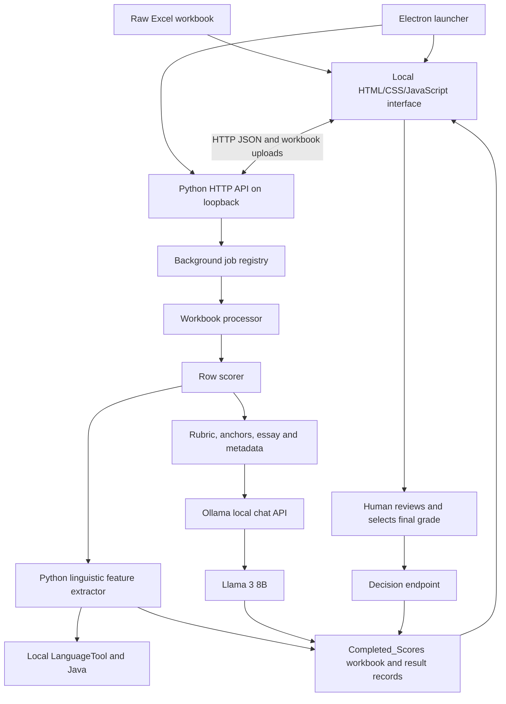

# HITL desktop and repository technical reference

Snapshot: October 19, 2026. Desktop source version: **0.1.3**.

## 1. Purpose and scope

Automated Essay Scoring (AES) estimates writing performance from an essay.
Human-in-the-loop (HITL) means the application keeps a human rater responsible
for the final assessment. Here, the intended task is ESL academic-writing
placement on a **1–6 ordinal scale**.

The application combines three responsibilities:

1. **Measure:** Python calculates observable lexical, syntactic, cohesion, and
   grammar-related features.
2. **Judge:** a local language model evaluates rubric traits requiring
   interpretation, such as organization and supporting detail.
3. **Decide:** a human reads the essay and evidence, then accepts or overrides
   the system recommendation and saves a final placement.

The system is hybrid in its use of complementary evidence. In the current
desktop, it does **not** calculate a learned fusion score or average the
rule-based score with the LLM score. The displayed **Model Score** is derived
from `llm_recommended_score`. The final score is the human's selection.

## 2. Repository map and separate execution paths

| Location | Responsibility | Relationship to the desktop |
| --- | --- | --- |
| `aes_feature_extractor.py` | Core linguistic features and manual 0–100 heuristic | Imported by the desktop scorer |
| `data/awl_word_forms.json` / `.csv` | Academic Word List word forms | JSON loaded by the extractor |
| `scripts/extract_awl_from_pdf.py` | Regenerates AWL data from a PDF | Preparation utility |
| `HITL/` | Local API, workbook processing, rubric scorer, review UI, tests | Main desktop application backend |
| `HITL/desktop/` | Electron launcher, sidecar builder, runtime packaging, installer | Native application wrapper |
| `hybrid LLM AES/` | Earlier hybrid batch scoring and evaluation; Ridge validation | Research path, not desktop model deployment |
| `NewAes/` | Grammar enrichment and another batch LLM feature workflow | Separate research implementation |
| `GColab Version/` | Colab versions of batch workflows with resume/checkpoint support | Separate hosted research environment |
| `prototype-ui/` | React/TypeScript/Vite review prototype using JSON fixtures | Separate prototype, not the Electron renderer |
| Root CSV/XLSX files | Input data and saved experiment outputs | Research/test artifacts; not all one dataset |

Important version differences:

- The **HITL scorer** asks for seven analytic traits and uses Level 4, 5, and 6
  anchor essays.
- The **NewAes/Colab scorer** asks for five analytic traits, a broad performance
  band, and an overall score; it includes anchors for Levels 1 through 6.
- The React prototype uses `score` as a temporary feature baseline and saves
  decisions in React state. That baseline is a source score, not an independent
  model prediction. Its confidence/rationale controls are not the desktop's
  current human-decision interface.

Do not describe the prototype's proposed Tauri integration as the technology
used by the present Electron desktop.

## 3. Architecture



The API and Ollama are separate processes communicating over local HTTP. Local
HTTP does not imply an internet-hosted service. In normal desktop configuration,
the endpoints use `127.0.0.1` on the same computer.

### Component responsibilities and source of truth

| Component | Source | What it actually does |
| --- | --- | --- |
| Desktop process manager | [main.cjs](../HITL/desktop/main.cjs) | Selects ports, provisions models, launches backend, opens window, captures logs, requests shutdown |
| Restricted bridge | [preload.cjs](../HITL/desktop/preload.cjs) | Exposes platform information as `window.hitlDesktop` |
| Reviewer interface | [index.html](../HITL/ui/index.html) | Upload, readiness checks, polling, essay navigation, evidence display, indicator alerts, decision saving |
| Local HTTP bridge | [local_api_server.py](../HITL/local_api_server.py) | Routes requests, saves uploads, serves UI, returns results and workbook downloads |
| Background job API | [app_backend.py](../HITL/app_backend.py) | UUID job IDs, thread execution, progress, errors, decision validation and persistence |
| Workbook processor | [hitl_processor.py](../HITL/hitl_processor.py) | Reads rows, validates columns, scores essays sequentially, initializes pending decisions, writes XLSX |
| Essay orchestrator | [hybrid_llm_aes.py](../HITL/hybrid_llm_aes.py) | Runs features and LLM assessment, normalizes output, handles Ollama lifecycle and retries |
| Rubric definition | [llm_rubric_prompt.py](../HITL/llm_rubric_prompt.py) | System instruction, six-level descriptors, three anchors, JSON keys |
| Language measurements | [aes_feature_extractor.py](../aes_feature_extractor.py) | NLP analysis, grammar checking, normalized weighted heuristic |
| Readiness checks | [preflight.py](../HITL/preflight.py) | Checks packages/resources, Java, paths, disk, Ollama server and model |
| Research evaluation | [evaluate_hybrid_results.py](../hybrid%20LLM%20AES/evaluate_hybrid_results.py) | Agreement metrics for saved score columns |
| Experimental calibration | [validate_hybrid_model.py](../hybrid%20LLM%20AES/validate_hybrid_model.py) | Train/test and repeated cross-validation for Ridge models |

## 4. Technologies used and why they are there

| Technology | Role in this repository | Reason for its role |
| --- | --- | --- |
| Electron | Desktop window and process lifecycle | Reuses the local web interface in a desktop application |
| HTML, CSS, vanilla JavaScript | Current desktop renderer | Single local interface with no remote scripts, fonts, or UI API dependency |
| Node.js/CommonJS | Electron launcher and build scripts | Launches sidecars and manages platform-specific files |
| Python | Scoring, I/O, job service | Integrates NLP and workbook tools |
| Python `http.server`, `threading`, `urllib` | Local API and model client | Standard-library HTTP service, background work, and Ollama calls |
| spaCy `en_core_web_sm` | Tokenization, sentence boundaries, POS tags, dependencies | Supplies linguistic structure for feature calculations |
| `wordfreq` | English Zipf frequency | Estimates how common the essay's vocabulary is |
| `lexical-diversity` | MTLD | Supplies a lexical diversity measure |
| NLTK `punkt` / `punkt_tab` | Sentence splitting for lexical overlap | Separates sentences before adjacent-sentence comparison |
| LanguageTool / `language-tool-python` | Local writing-rule matches | Supplies grammar-related error-density evidence |
| Java runtime | Executes LanguageTool | Required by the local grammar engine |
| Ollama | Runs and serves model inference | Provides local model storage, loading, and chat endpoint |
| Meta Llama 3, `llama3:8b` | Semantic/rubric assessor | Produces trait grades, overall recommendation, and justification |
| `openpyxl` | Excel reading/writing | Workbook input, completed results, human decisions |
| PyInstaller | Frozen Python sidecar | Packages the backend and dependencies for distribution |
| `electron-builder` | Desktop packaging | Platform targets include Windows NSIS, macOS DMG, Linux AppImage |
| C#/.NET installer helper and 7-Zip inputs | Windows handoff installer | Installs/replaces packaged application and creates shortcuts |
| pandas and PyMuPDF | Other repository workflows | Data processing and PDF/AWL preparation, not core desktop UI frameworks |

The desktop package specifies Electron `^32.3.3` and electron-builder `^25.1.8`;
these are dependency ranges. The lockfile records resolved versions. Root
Python requirements are mostly unpinned; `setuptools<81` supports the existing
lexical-diversity dependency. Record installed versions for reproducible studies.

Ollama's published `llama3:8b` listing identifies approximately 8.03 billion
parameters, Q4_0 quantization, and a 4.7 GB download. This is reference information,
not proof of the exact model digest in every local installation. Capture the
actual installed model metadata before reporting an experiment.
[Official model listing](https://ollama.com/library/llama3:8b).

The project does not train Llama 3 from scratch or fine-tune its weights. Its
customization is **prompt-based assessment with calibration examples**. The
manual AES score is rule-based, but spaCy's parser is itself a pretrained NLP
model; saying that the entire application contains no machine learning would
be inaccurate.

## 5. What the reviewer sees

The current desktop interface contains these functional areas:

1. **Process Workbook:** select an XLSX file and map Student ID, Topic, and
   Essay headers. A Sample button runs the first essay of the packaged workbook
   using its `id` header (the sample endpoint sets `limit=1`).
2. **Processing:** job ID, status, essay count, field count, progress, recovery
   messages, and completed-workbook download.
3. **Availability:** local dependencies/runtime checks plus Test Scoring.
4. **Review Workbook:** load an already-completed workbook without model rescoring.
5. **Review dashboard:** total, pending, review, finalized, and mismatch counts.
6. **Essay queue:** selector, previous/next, Next Pending, decision timestamp.
7. **Essay and score panel:** prompt, full essay, model grade, human final grade,
   writing indicators, and possible mismatch warning.
8. **Model Evaluation:** five displayed trait aliases and the LLM justification.
9. **Human Decision:** grade 1–6, derived placement/action/status/notes, Accept
   System Decision, Save Decision, and updated workbook download.

The five displayed traits are organization, support, development,
comprehensibility, and prompt fulfillment. Two additional assessed traits,
abstract elaboration and grammar meaning impact, remain in the output columns.

The current desktop notes display is read-only. The interface automatically
describes score differences; it does not provide the prototype's free-form
rationale/confidence inputs. The Python decision API can receive `Reason_Notes`.

## 6. End-to-end essay processing

### 6.1 Start and prepare

Electron creates writable user-data folders for uploads, outputs, logs, and
Ollama models. It copies missing bundled model files, can reconstruct chunked
model files, selects local ports, and starts the frozen backend when available.
Development fallback uses a Python executable. It waits for `/health` before
opening the local dashboard.

The UI uploads a workbook to `POST /jobs`. The service saves it under a unique
upload directory and returns a job ID and status/result/download URLs. A daemon
thread performs processing while the UI polls for progress. The in-memory
registry uses a reentrant lock. Within each workbook, essays are processed
sequentially; this is not distributed batch inference.

### 6.2 Read and normalize

Default columns are `Student ID`, `Topic`, and `Essay`. The packaged
`HITL/Essays.xlsx` instead has `id`, `Topic`, and `Essay`; the sample endpoint
maps that ID explicitly. Manual upload of that file needs the same mapping.
API/CLI callers can
specify other names. The processor reads the first worksheet unless one is
selected, removes blank-header columns, skips wholly blank rows, and validates
configured headers. Values are normalized into strings and known spacing/BOM
artifacts are cleaned. Student grammar is not corrected before scoring.

XLSX loading uses `data_only=True`: formula cells supply cached values, not
formula recalculation. Preserve paragraph breaks inside the essay cell.

### 6.3 Extract and assess

For each essay, `evaluate_row()`:

1. Reads essay text, ID, and prompt/topic.
2. Counts visible paragraphs.
3. Calls `evaluate_essay()` for language features and the manual AES score.
4. Builds the LLM prompt using the rubric, three anchors, essay ID, prompt/topic,
   paragraph count, and full essay text.
5. Calls Ollama and parses its JSON response.
6. Normalizes seven trait scores and one recommendation to whole grades 1–6.
7. Merges original fields, `aes_*` fields, `llm_*` fields, and workbook aliases.
8. Sets human decision fields to blank and `Decision_Status` to `Pending`.

**Only paragraph count, ID, prompt/topic, and essay text are inserted as target
metadata in the LLM prompt.** The measured MTLD, AWL ratio, grammar density, and
manual AES score are not supplied to Llama 3. They are calculated alongside it
for evidence, later modeling, and review.

### 6.4 Write and review

After all essays finish, the processor writes a new workbook with one
`Completed_Scores` sheet and returns the same rows as structured UI records.
The output has styled headers, a frozen first row, filters, and bounded widths.
It preserves original row fields but does not clone every source worksheet,
formula, or original formatting.

The workflow provides a completed workbook that can be downloaded and loaded
for review. Loading review data calls `load_completed_workbook()`, not the LLM.
Each human decision updates the job's records and rewrites its output workbook.
The raw uploaded file is separate from that generated output.

## 7. Rule-based linguistic evidence

### 7.1 Feature dictionary

| Feature | Exact computation or implementation | Interpretation and limits |
| --- | --- | --- |
| `word_count` | Number of spaCy tokens with `is_alpha`, lowercased | Alphabetic token count; differs from whitespace/Word counts |
| `sentence_count` | Nonempty spaCy sentences; nonempty fallback is 1 | Surface production, not argument quality |
| `mean_sentence_length` | Alphabetic words / sentences | Length, not proof of good syntax |
| `avg_word_freq` | Mean `zipf_frequency(word, "en")` | Lower means rarer words; rarity is not correctness |
| `mtld` | `lexical_diversity.lex_div.mtld(words)` | Lexical variety; <2 words or an exception returns 0 |
| `awl_ratio` | AWL-matching word tokens / alphabetic word tokens | Proportion, e.g. 0.08 = 8%; not unique AWL families |
| `clause_density` | Count of `ccomp`, `xcomp`, `advcl` dependency labels / word count | Restricted clause proxy; not all English clauses |
| `dependency_depth` | Mean hops to sentence root over non-space tokens | Dependency structure depth; includes more than alphabetic words |
| `noun_complexity` | Mean direct child count of tokens tagged `NOUN` | Noun modification proxy; not full noun-phrase analysis |
| `connective_density` | Regex occurrences from a fixed connective list × 100 / words | Presence, not correctness of discourse relations |
| `lexical_overlap` | Mean adjacent-sentence Jaccard similarity | Repeated words may support cohesion or indicate repetition |
| `grammar_errors_per_100` | LanguageTool match count × 100 / words | Tool matches, not a verified count of every grammatical error |
| `paragraph_count` | Nonempty blocks split by blank lines | Sensitive to workbook line-break preservation |
| `type_token_ratio` | Unique lowercase regex words / all regex words | Highly sensitive to essay length |
| `avg_word_length` | Total characters in regex words / regex words | Orthographic length, not semantic sophistication |

The first twelve are from the shared extractor. HITL adds paragraph count, TTR,
and mean word length. Its TTR/word-length regex is `\b[a-zA-Z]+\b`, so its token
denominator can differ from spaCy's word count, especially for contractions.

The local AWL dataset contains **3,111 unique word forms** across sublists 1–10.
If its JSON cannot be loaded, the extractor falls back to an embedded smaller
word set. A fallback changes feature comparability and must be reported.

For lexical overlap, if adjacent sets are A and B, Jaccard =
`len(A intersection B) / len(A union B)`. The sets include common function words;
there is no semantic embedding or stop-word removal in that calculation.

### 7.2 Manual AES score

Only four components contribute to the manual score:

| Component | Normalization interval | Direction | Weight |
| --- | --- | --- | --- |
| MTLD | 20–100 | Higher receives more credit | 0.25 |
| AWL ratio | 0–0.20 | Higher receives more credit | 0.30 |
| Average Zipf frequency | 2–6 | Lower receives more credit | 0.20 |
| Grammar matches per 100 words | 0–20 | Lower receives more credit | 0.25 |

For each component, `N(x) = clip((x - minimum)/(maximum - minimum), 0, 1)`.
Inverted components use `1 - N(x)`.

```text
AES score = 100 × sum(weight × normalized component)
                  / sum(weights of available components)
```

These are hand-chosen weights and bounds, not learned regression coefficients.
Other extracted features are retained but are not used by this formula.

If grammar checking fails, grammar is `None`, not zero errors. The grammar
component is excluded and the remaining weights are renormalized. If every
component is unavailable, `compute_score()` returns `None`. Scores are rounded
to five decimal places.

Example: MTLD=60, AWL=0.10, Zipf=4, grammar=4/100 produces normalized values
0.50, 0.50, 0.50, 0.80, giving **57.5/100**. For research comparison only,
`1 + 5 × 57.5/100 = 3.875` on the 1–6 scale. Neither value automatically becomes
the desktop's final grade.

## 8. How Llama 3 evaluates writing

### 8.1 Assessment method

The system message assigns an ESL-assessor role, requests conservative,
evidence-based judgments, and requires JSON. The user message includes the
rubric, full calibration essays, target metadata, and target essay.

This is a few-shot prompting approach: examples are provided in context at
inference time. The model uses its pretrained language representations to
generate rubric judgments. There is no code-accessible explanation of its
internal reasoning. The justification is generated assessment text, not proof
that every judgment is correct.

### 8.2 Seven scored traits

| Trait | Question answered |
| --- | --- |
| Organization | Are ideas ordered logically and connected coherently? |
| Paragraph development | Are paragraphs substantively developed? |
| Supporting detail | Are reasons, examples, and concrete support adequate? |
| Abstract elaboration | Does the writer move beyond concrete detail into explanation or reflection? |
| Prompt control | Does the response remain relevant to the assigned task? |
| Comprehensibility | How much effort does an unfamiliar native reader need to understand it? |
| Grammar meaning impact | Do grammar/vocabulary problems interfere with communication? |

Higher scores represent stronger performance, including less meaning disruption
for grammar meaning impact. LanguageTool counts rule matches; the LLM judges
their communicative consequences. The prompt explicitly discourages counting
the grammar penalty twice.

The overall `llm_recommended_score` is generated by the model separately. There
is no implemented equation that averages the trait scores or assigns them
fixed percentage weights.

### 8.3 Exact six-level rubric summarized

| Grade | Organization and development | Support and language/meaning |
| --- | --- | --- |
| 6 | Clearly organized; accurate cohesion; fully developed; 4+ paragraphs | Developed concrete support and some abstraction; strong grammar control, infrequent errors; easily understood |
| 5 | Clear organization; some accurate cohesion; 4 paragraphs | Concrete support; moderate vocabulary/grammar control; errors do not block meaning; understandable with some effort |
| 4 | Partial organization; limited/inconsistent cohesion; 2–3 paragraphs | Personal and sometimes concrete detail; errors may distort meaning, but generally understandable |
| 3 | Weak organization; listed/loose ideas; 1–2 or underdeveloped paragraphs | Limited/repetitive/general support; frequent errors may distort meaning; understandable only with effort |
| 2 | Minimal organization and very limited development | Little relevant support; frequent errors often block meaning; difficult to understand |
| 1 | Fragmentary, memorized, mostly off-topic, or very limited | Little/no development; mostly unclear meaning; insufficient control for Level 2 |

These are the descriptors encoded in this repository, not independently
verified institutional policy. The code supplies paragraph quantity but tells
the model to judge development quality and not reward length alone. The
paragraph descriptors are prompt guidance, not hard-coded score gates.

The prompt tells the model to require clear Level 4 evidence for grades ≥4 and
clear organization, development, support, and comprehensibility for grades ≥5.
The Level 4/5/6 anchors are calibration examples, not essays retrieved from a
database. The model is instructed not to reward matching topics or copy anchor
language into its justification.

### 8.4 Request and response handling

The request to `/api/chat` includes `model`, system/user `messages`,
`format: "json"`, `stream: false`, and temperature **0.0** by default. It uses
Python `urllib`, not the Ollama Python SDK. JSON mode and non-streaming are
supported by [Ollama's official chat API](https://docs.ollama.com/api/chat).

Temperature zero reduces sampling variation; it does not establish perfect
reproducibility across machines, runtime/model versions, and configurations.
The normal scoring request does not explicitly set `seed`, `num_ctx`, or an
output-token budget. Effective context length should be verified: anchors plus
the essay must fit the actual runtime context. Ollama exposes such controls in
its [parameter reference](https://docs.ollama.com/modelfile).

The parser accepts JSON and can extract a JSON object from surrounding text.
It does not enforce a full required-key/type schema. Score normalization rounds
using `floor(value + 0.5)` and bounds values to 1–6. Missing or common nonnumeric
score values fall back to 1. Thus valid JSON alone does not guarantee a complete,
valid assessment; schema validation remains a limitation.

## 9. Dashboard indicators and mismatch criteria

These thresholds are **display/review heuristics**, not calibrated probabilities
or additional placement cutoffs.

| Displayed measure | Low / rank 1 | Developing / rank 2 | Strong / rank 3 |
| --- | --- | --- | --- |
| Word count | <150 | 150 to <300 | ≥300 |
| Sentence count | <8 | 8 to <15 | ≥15 |
| Grammar matches / 100 | >7, Many Errors | >3 to 7, Some Errors | ≤3, Clean |
| Type-token ratio | <0.35 | 0.35 to <0.50 | ≥0.50 |
| AWL ratio | <0.04 | 0.04 to <0.08 | ≥0.08 |

The UI accepts AWL values >1 as percentages and divides them by 100. New
processor outputs use proportions.

The indicator composite is the unweighted average of the five ranks:

- Average ≥2.6 → strong writing signals, rank 3.
- Average ≥1.7 and <2.6 → developing signals, rank 2.
- Average <1.7 → low signals, rank 1.

The model band is grade 1–3 → low/rank 1; grade 4 → developing/rank 2; grade
5–6 → strong/rank 3. A mismatch is flagged when the absolute rank difference
is at least 2, effectively **low versus strong**. A one-band difference is not
flagged. Mismatches direct human attention; they do not change the model grade.

Current implementation caveat: the UI's numeric conversion uses JavaScript
`Number(value)`, which converts `null` and an empty string to zero. Missing
grammar evidence can therefore look like a clean grammar signal in the UI,
even though the Python score correctly excludes it. Missing indicators should
be inspected before using mismatch counts as research evidence. This
documentation records the behavior; it does not change that implementation.

## 10. Human decisions and placement

Freshly scored essays remain pending with no human final score. A human may
choose any integer 1–6, or click Accept System Decision to save the current
model recommendation. The API rejects fractional, nonfinite, and out-of-range
human final scores.

| Human final score | Placement derived by the application |
| --- | --- |
| 1, 2, 3 | Pre-EIL |
| 4 | EIL 1 |
| 5 | EIL 2 |
| 6 | Test Out |

The UI labels the action `Override score` when the selected grade differs by
at least one point, otherwise `Accept system score`. It derives the placement,
sets status to `Finalized`, and creates a short note about the numeric
difference. The backend independently derives placement from the final score
and records a UTC update timestamp.

Human fields are `Rater_Final_Score`, `Rater_Final_Placement`, `Rater_Action`,
`Decision_Status`, `Reason_Notes`, and `Decision_Updated_At`.

Saving a decision does not update Llama's weights, update prompt anchors, or
train a new model. This is human review and data collection, not implemented
online active learning. It stores the latest decision; there is no authenticated
rater ID or append-only revision history in this path.

## 11. Data contracts and persistence

### Inputs and output families

The desktop upload API accepts `.xlsx`. The standalone/batch scripts also
support CSV. Original columns are preserved as row data, with generated
families appended:

- `aes_*`: manual score and measured features.
- `llm_*`: seven traits, recommendation, justification.
- Workbook-friendly aliases: essay identity/text, five traits, eight measurements.
- Human fields: final grade, placement, action, state, notes, timestamp.

Key aliases:

| UI/workbook column | Source |
| --- | --- |
| `Essay_ID`, `Essay_Text` | Selected ID/text input |
| `LLM_Organization_Coherence` | `llm_organization` |
| `LLM_Supporting_Detail` | `llm_supporting_detail` |
| `LLM_Paragraph_Development` | `llm_paragraph_development` |
| `LLM_Comprehensibility` | `llm_comprehensibility` |
| `LLM_Prompt_Fulfillment` | `llm_prompt_control` |
| `Word_Count`, `Sentence_Count`, `Paragraph_Count` | Corresponding `aes_*` features |
| `Grammar_Errors_per_100` | `aes_grammar_errors_per_100` |
| `Type_Token_Ratio`, `Avg_Word_Length`, `AWL_Ratio` | Corresponding `aes_*` features |

Generated keys can replace same-named source keys. Do not assume arbitrary
preexisting `aes_*`/`llm_*` columns are preserved as separate historical runs.

### HTTP API

| Method/path | Purpose |
| --- | --- |
| `GET /` | Serve current desktop UI |
| `GET /health` | Backend alive and app version |
| `GET /preflight` | Dependencies, paths, model availability, runtime provenance |
| `POST /inference-check` | Short model generation probe; unavailable during active jobs |
| `POST /jobs` | Upload workbook or submit local path as JSON |
| `POST /sample-job` | Process packaged sample workbook |
| `GET /jobs/<id>` | Job status/progress/error |
| `GET /jobs/<id>/result` | Completed columns and records |
| `GET /jobs/<id>/download` | Download generated workbook |
| `POST /review-workbook` | Load completed workbook without rescoring |
| `POST /jobs/<id>/decision` | Save one row's human decision |
| `POST /shutdown` | Shut down local server and owned runtime |

Job states are `queued`, `running`, `completed`, and `failed`. Essay decision
states are a different concept: `Pending`, `Review`, `Finalized`.

The Python public entry points are `start_job()`, `get_job_status()`,
`get_job_result()`, `load_review_workbook()`, and `update_job_decision()`.
Decision updates address a zero-based row index within the job.

The registry is in memory. XLSX output provides durable results; reopening a
completed workbook restores review data under a new job. The current processor
writes scoring results after the entire workbook succeeds. It has no per-essay
disk checkpoint/resume feature. A failed later essay can prevent creation of
the completed workbook, even though earlier results existed in memory.

## 12. Offline runtime, packaging, and failure handling

### Local runtime

The standalone API defaults to `127.0.0.1:8765` and Ollama
`127.0.0.1:11434/api/chat`. Electron prefers backend port 8765, falls back to a
free port, and selects a free private Ollama port. The backend owns that managed
Ollama instance. An explicit `HITL_OLLAMA_URL` selects an externally configured
endpoint instead; the ownership logic does not restart/stop that external service.

In development, uploads and outputs default to `HITL/uploads` and `HITL/outputs`.
In Electron, paths are rooted at `app.getPath("userData")`:

```text
runtime/uploads/
runtime/outputs/
models/ollama/
logs/hitl-backend.log
```

There is no cloud scoring dependency in the default workflow. Offline use
requires the model, Python resources, Java, and LanguageTool data to be installed
or bundled beforehand. Missing LanguageTool cache data can trigger a first-use
download in an incomplete build. The sidecar builder explicitly warns about this.

### Readiness and generation checks

Preflight checks Python/resources, packages, spaCy model, NLTK data, Java, AWL,
sample workbook, writable directories, free disk space, Ollama executable,
server, and requested model. Its default free-disk threshold is **8 GB**, not a
validated minimum memory/hardware specification. The Python version check says
3.9+, but the HTTP bridge imports `cgi`; do not interpret that lower-bound check
as proof of compatibility with every later Python release. The verification
environment used Python 3.12.10.

`/health` proves that the backend responds. `/preflight` checks availability.
Test Scoring calls `/inference-check`, which asks for a tiny JSON response with
a 120-second timeout and `num_predict=32`. It proves a generation request can
complete; it is not an essay-scoring accuracy test.

### Recovery limits

Normal essay LLM requests have a **600-second total request deadline**. JSON
failures have at most two retries. Recoverable connection/runner interruptions
have a separate two-retry budget, with a three-second recovery delay. Retries
share the original deadline; they do not start a new ten-minute allowance.
Missing-model/endpoint errors such as HTTP 404 fail directly.

On Windows, grammar checking tries the Java CLI first, then a bounded Python
worker fallback; other platforms reverse the order. Default limits are 45
seconds for CLI and 20 seconds for worker checking. Failure leaves missing
grammar evidence and scoring proceeds with the remaining components.

Backend exceptions store the original traceback and error type in job state
and logs. Shutdown is coordinated to avoid retry logic restarting a stopped
owned runtime. These recovery features improve execution reliability, not
assessment validity.

### Distribution

The PyInstaller build includes the backend, relevant Python/NLP assets, sample,
UI, AWL JSON, and available LanguageTool cache. Separate runtime assets supply
Java, Ollama, and the model store. Electron-builder packages platform resources.
The Windows handoff also uses a custom setup executable with `7za.exe` and
`hitl-app.7z`. Build native sidecars and runtime binaries on the target OS and
architecture. Generated binaries/model stores/installers are ignored by Git.

The handoff documents report Windows offline and replacement-install tests.
This documentation audit did not independently rerun installation or certify
all platform builds. See the platform handoffs for their stated evidence.

The renderer uses `contextIsolation: true` and `nodeIntegration: false`, with
`sandbox: false`. The local API has no application authentication, and workbook
files are not encrypted by this implementation. Local processing supports data
control, but it is not proof of comprehensive security or privacy compliance.

## 13. Research models and defensible claims

The research validator tests:

1. Manual AES score scaled by `1 + 5 × aes_score/100`.
2. Direct LLM recommendation.
3. Ridge regression over 13 AES features (12 core plus paragraph count).
4. Ridge over seven LLM traits.
5. Ridge over AES features plus the LLM recommendation.
6. Ridge over AES features plus seven LLM traits, 20 features in total.

TTR and mean word length added in HITL are not part of that validator's default
feature list. Ridge is implemented using the Python standard library, with
mean imputation, training-set standardization, an unregularized intercept,
alpha=10 by default, and predictions clipped to 1–6. There is no scikit-learn
training dependency in that script.

The default evaluation uses seed 42, a 25% holdout, and repeated five-fold CV
over 20 shuffles. Each repetition pools out-of-fold predictions before computing
metrics, then metrics are averaged across repetitions. The reported `n=820`
means 41 essays × 20 repetitions; it is not 820 independent essays. Direct
predictions are fixed, so their repeated-CV metrics remain their full-sample metrics.

For verified numbers and metric-definition differences, use the
[validation report](VALIDATION_REPORT.md). The available small historical run
supports a preliminary comparison. It does not establish that the current
whole-grade desktop, a different batch scorer, or human-assisted decisions
achieve those same results.

## 14. Limitations to be ready to explain

| Issue | Consequence and research response |
| --- | --- |
| Historical scores differ from current whole-grade output | Regenerate and evaluate the current release before claiming current accuracy |
| Only 41 essays in reproduced experiment; prompt imbalance | Use larger, independent and prompt-diverse data; report uncertainty |
| No measured human-human agreement in reproduced report | Establish rater reliability and adjudication before judging model ceiling |
| Prompt/topic may be a short label | Supply the full writing task for defensible prompt-fulfillment judgments |
| Paragraph counting depends on blank lines | Preserve input formatting; a single-line break may remain inside one counted block |
| Missing numeric UI values can become zero | Review missingness; do not interpret every clean/mismatch badge as valid evidence |
| JSON is not fully schema-validated | Missing scores can become grade 1; stricter validation is future work |
| LLM is susceptible to bias, context limits, and essay-embedded instructions | Test repeated scoring, subgroup performance, truncation, and prompt injection |
| Word count/TTR/AWL thresholds are manual | Validate thresholds for the intended task; length and rarity are imperfect proxies |
| Overall score is generated independently of traits | Check internal consistency; no guaranteed arithmetic relationship |
| No automated model retraining from overrides | Treat decisions as review data; a later calibrated model requires a separate study |
| Latest-value workbook persistence | Add rater identities and revision history for a stronger audit trail |
| No desktop checkpoint/resume | Use small demonstration batches; test failure recovery and persistence separately |
| No dedicated plagiarism, authorship, or factual-verification system | Do not claim those capabilities from rubric scoring |

The strongest accurate description is: **a local HITL assessment application
combining transparent linguistic evidence with prompted LLM rubric judgments,
with separate exploratory experiments on statistical feature fusion.**
